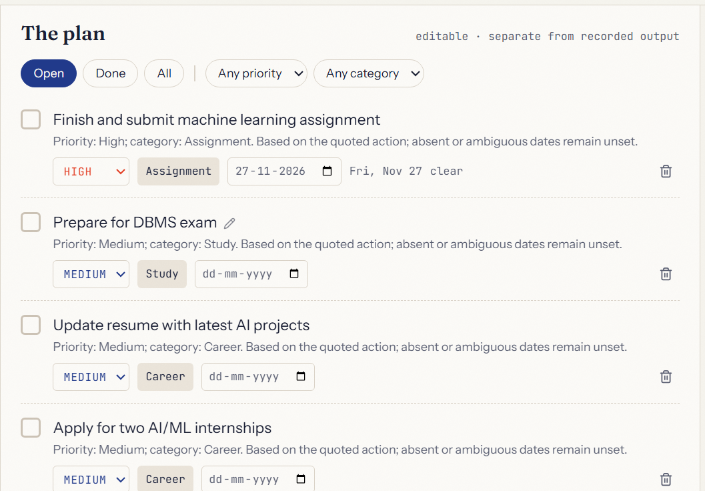
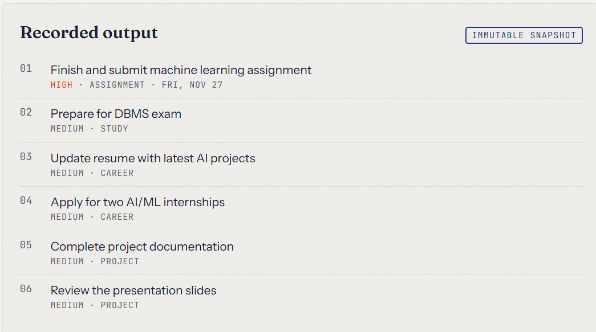
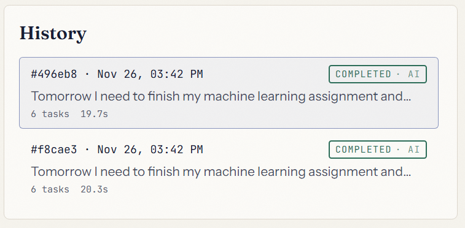
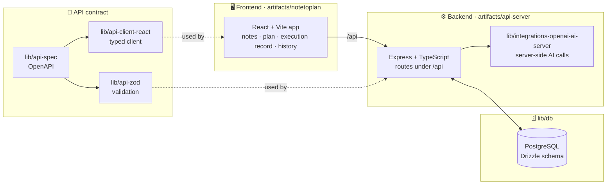
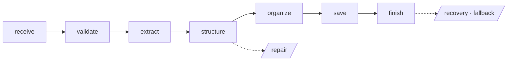

<div align="center">




<br/>

<a href="https://note-to-plan-planner.replit.app/"></a>

<br/><br/>


</div>

<br/>

## 🧾 What is NoteToPlan?

NoteToPlan is a full-stack productivity app that turns scattered notes into an editable, prioritized plan, and shows you exactly how it got there.

Paste in half-finished thoughts. The backend validates, extracts, structures and organizes them into tasks with a priority, a category and a due date where one can be found. While it works, a **live workflow diagram** shows each real processing step. Every run is saved, so you can open the **execution history** later and see what the app actually did.

Most AI planners hand you a list and ask for trust. NoteToPlan hands you the list **and the receipt**.

<br/>

## 📸 Screenshots

<p align="center">
  
</p>
<p align="center"><sub><b>Notes in, execution record out.</b> Each step of a run shows its status.</sub></p>

<table>
  <tr>
    <td width="50%" valign="top">
      
      <p align="center"><sub><b>The plan.</b> Editable and kept separate from the recorded output.</sub></p>
    </td>
    <td width="50%" valign="top">
      
      <p align="center"><sub><b>Recorded output.</b> An immutable snapshot of the run.</sub></p>
    </td>
  </tr>
  <tr>
    <td colspan="2" align="center">
      
      <p align="center"><sub><b>History.</b> Every run, with its status, task count and duration.</sub></p>
    </td>
  </tr>
</table>

<p align="center"><b>▶ <a href="https://note-to-plan-planner.replit.app/">Try the live app</a></b></p>

<br/>

## ✨ Features

| | Feature | Details |
|---|---|---|
| 📝 | **Notes to tasks** | Paste free-form notes (up to 20,000 characters) and get structured tasks back. An *Insert sample notes* button loads an example. |
| ⌨️ | **Fast input** | Submit with **Turn into a plan** or `Ctrl/Cmd + Enter`. Your draft is kept on your device. |
| 🧭 | **Live workflow diagram** | The execution record draws the real pipeline as it runs: `receive → validate → extract → structure → organize → save → finish`. |
| 🧾 | **Honest execution record** | Every event of a run is recorded with a status per step (`SUCCEEDED`, `SKIPPED`, `PENDING`). Optional `repair`, `recovery` and `fallback` steps are shown too, and stay skipped or pending when a run goes cleanly. |
| 🔒 | **Immutable recorded output** | What the run produced is stored as a read-only snapshot, separate from the plan you edit. |
| ✏️ | **Editable plan** | Tick tasks off, rename them, change priority, category and due date, or delete them. Filter by Open / Done / All, priority, and category. |
| 📅 | **Careful with dates** | Absent or ambiguous dates are left unset instead of guessed. |
| 🕘 | **Run history + rerun** | Each run has an ID, timestamp, status, task count and duration. Open an old one, or rerun the same notes. |
| 🔌 | **Typed API contract** | One OpenAPI spec generates the React API client and Zod validators, so the frontend and backend stay in sync. |
| 🔐 | **Server-side AI** | AI calls run on the Express backend. Credentials are configured in the server environment and are not part of the source. |

<br/>

## 🎮 How to Use It

1. **Open the app** → [note-to-plan-planner.replit.app](https://note-to-plan-planner.replit.app/)
2. **Dump your notes** into the *Device draft* box, or tap *Insert sample notes*.
3. **Press *Turn into a plan*** (or `Ctrl/Cmd + Enter`).
4. **Watch the execution record** fill in, step by step.
5. **Review the recorded output**, then **edit the plan**: adjust priorities, categories and dates, and check tasks off.
6. **Come back to History** any time to inspect a past run or rerun the same notes.

<br/>

## 🏗️ Architecture

The frontend and backend are separate services. The browser talks to the Express API under `/api`. The API contract lives in one OpenAPI spec, and typed clients are generated from it.



### The pipeline



Solid steps run on every run. The dashed steps (`repair`, `recovery`, `fallback`) are optional and show as skipped or pending when a run succeeds without them.

<br/>

## 🧰 Tech Stack

| Layer | Technology |
|---|---|
| **Frontend** | React, Vite |
| **Backend** | Node.js 24, Express, TypeScript |
| **Database** | PostgreSQL with Drizzle (schema and config in `lib/db`) |
| **API contract** | OpenAPI spec, generated typed React client, Zod validation |
| **AI** | Server-side OpenAI integration |
| **Tooling** | pnpm workspace, Replit service configuration |

<br/>

## 🚀 Getting Started

### Prerequisites

- **Node.js 24** and **pnpm**
- **PostgreSQL**
- **Server-side AI configuration.** Set the required environment variables securely in the environment where you run the app. Never commit credentials.

### Install and check

```bash
pnpm install --frozen-lockfile
pnpm run typecheck
pnpm run test:notetoplan
```

### Run it

The frontend and backend run as two services, and API requests go to `/api`. If you host outside Replit, set up equivalent routing and the required service environment first. See [`replit.md`](replit.md) and each service's `package.json` for project-specific commands.

> Cloning the code doesn't copy the live app's database. Notes and tasks are not part of the source.

<br/>

## 📁 Project Structure

```text
.
├── artifacts/
│   ├── notetoplan/                      # React + Vite frontend
│   └── api-server/                      # Express + TypeScript backend and tests
├── lib/
│   ├── db/                              # PostgreSQL schema and Drizzle config
│   ├── api-spec/                        # OpenAPI contract and client generation
│   ├── api-client-react/                # Generated typed API client
│   ├── api-zod/                         # Zod validation schemas
│   └── integrations-openai-ai-server/   # Server-side AI integration
├── docs/
│   ├── assets/banner.svg                # Animated README banner
│   └── screenshots/                     # README screenshots
├── replit.md                            # Project notes for Replit
└── ...                                  # Workspace config, lockfile, scripts
```

<br/>

## 👩‍💻 Developer

**Shabreen Taj** · AI/ML developer and B.Tech CSE student

<p>
  <a href="https://github.com/taj-shabreen"></a>
  <a href="https://pshabreentaj.com"></a>
  <a href="https://linkedin.com/in/shabreen-taj77"></a>
</p>

<div align="center">

<br/>

Your notes, a practical plan, and an honest record of every processing step.

</div>
